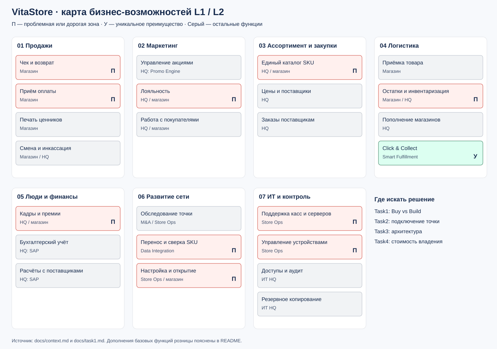

# Задание 1. Возможности и выбор решений

## Карта L1/L2

На карте L1 обозначает направление работы, L2 — конкретную возможность. Красный цвет и метка «П» показывают дорогие или проблемные функции. Зелёный и метка «У» обозначают преимущество VitaStore. Остальные функции показаны серым. Цвет описывает текущее состояние, а не способ размещения системы.

| L1 | L2: возможности | Кто выполняет | Что меняем |
| --- | --- | --- | --- |
| Продажи | Чек и возврат; приём оплаты; ценники; кассовая смена и инкассация | Магазин; правила и контроль в HQ | Убираем разные кассовые программы и встроенные драйверы |
| Маркетинг | Акции; лояльность; работа с покупателями | HQ; применение в магазине | Закрываем локальные тетрадки лояльности, сохраняем единые правила акций |
| Ассортимент и закупки | Каталог SKU; цены; выбор поставщиков; заказы | Коммерческий отдел HQ; локальная приёмка | SAP становится источником согласованных товаров и цен |
| Логистика | Приёмка; остатки и инвентаризация; пополнение; Click & Collect | Магазин и HQ | Общий учёт в ERP; собственный Smart Fulfillment сохраняем |
| Люди и финансы | Кадры и премии; бухгалтерия; расчёты с поставщиками | HQ; магазин передаёт первичные данные | Убираем местный расчёт премий, используем имеющийся SAP |
| Развитие сети | Обследование точки; перенос SKU; настройка и открытие | M&A, Data Integration, Store Ops | Заменяем поездки ради выгрузки и ручное сведение файлов управляемым процессом |
| ИТ и контроль | Поддержка касс; управление устройствами; доступы; резервирование и аудит | Store Ops и ИТ HQ | Убираем серверы из подсобок, вводим удалённое управление и единый журнал |

Закупки, инвентаризация, управление доступом и аудит дополняют карту как необходимые функции розницы. Их текущее устройство кейс не описывает; конкретные проблемы в этих областях не предполагаем.

## Матрица Buy vs Build

| Возможность | Решение и размещение | Почему | Условие выбора / владелец |
| --- | --- | --- | --- |
| Продажи, возвраты, ценники, смены | Buy: Cloud POS SaaS с лёгким приложением | Стандартная функция, собственная кассовая платформа не даёт преимущества | Офлайн-наличные, выгрузка данных, API; Store Ops |
| Управление устройствами | Buy: MDM SaaS | Настройка планшета по шаблону снижает число выездов | Удалённая блокировка, поэтапные обновления; Store Ops |
| Платежи и фискальная печать | Buy: готовый HAL/SDK на планшете; шлюз провайдера онлайн | Драйверы обслуживает поставщик, интерфейс кассы остаётся прежним | Проверенная матрица «ОС × модель × прошивка × протокол»; Store Ops |
| Лояльность | Buy: модуль Cloud POS, единый счёт в облаке | Локальные записи дублируют центральный учёт | План переноса балансов и запрет офлайн-списания; коммерческий отдел |
| Акции | Сохранить Promo Engine in-house; Migrate в PaaS после пилота | Уже есть единый движок; замена добавит затраты и риск расхождения скидок | POS умеет применять версионированные правила; коммерческий отдел |
| Каталог, цены, закупки, товарный учёт | Reuse: SAP on-premises | Эти функции уже оплачены и централизованы; перенос ERP не нужен для отказа от серверов в магазинах | Интеграционный API и владелец справочника; ERP-команда |
| Кадры, премии, бухгалтерия | Reuse: SAP on-premises | Дублирование в магазинах убираем без покупки новой HR-системы | Согласовать единые правила расчёта; финансы и HR |
| Click & Collect и распределение заказов | Build / Migrate: Smart Fulfillment на PaaS, управляемая БД | Собственная логика доступности товаров — преимущество сети | Сохранить алгоритмы и SLA, проверить перенос БД; команда логистики |
| SKU Matching | Buy: модель как сервис; Build: правила, проверка и очередь исключений на PaaS | Похожие названия ищет готовая модель; правила соответствия контролирует VitaStore | Модель выбирает только существующий SKU; Data Integration |
| Обмен с SAP и журнал продаж | Build: небольшой интеграционный сервис на PaaS | Нужно связать SaaS с внутренними системами и исключить повторные проводки | Повторная доставка, сверка, экспорт и аудит; Data Integration |
| Мониторинг, резервные копии | Buy: возможности SaaS и облака | Не создаём отдельную инфраструктуру обслуживания | Проверяем восстановление и сроки хранения; Store Ops |

Физические действия остаются в магазине: выдача товара, приёмка, инкассация и подключение оборудования. Облако хранит документы и правила этих операций. Сам банковский терминал и фискальный регистратор тоже остаются на месте.

## Что объединяем и что сохраняем

Разные локальные каталоги сверяем с SAP, местные расчёты премий переносим в SAP, тетрадки лояльности заменяем единым счётом. Cloud POS использует цены SAP и правила Promo Engine; второй независимый расчёт акций не запускаем. Smart Fulfillment сохраняем как собственный продукт. Статус in-house относится к владению кодом, поэтому он совместим с размещением в PaaS.

Выбран стек классов сервисов, без обещания совместимости конкретного поставщика: Cloud POS + MDM + HAL, управляемые приложения и PostgreSQL, очередь сообщений, объектное хранилище, сервис модели. Поставщика выбираем после демонстрации офлайн-чека, восстановления обмена и работы с реальными устройствами. Расходы на этот стек включены в [TCO](../Task4/README.md).
