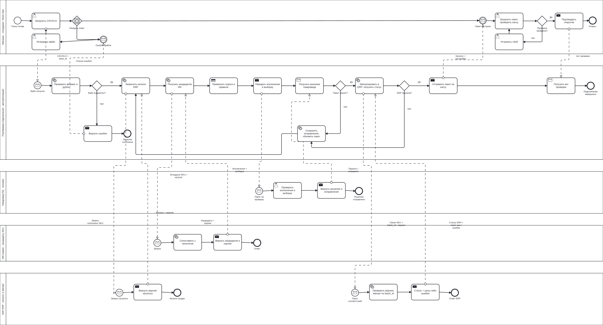

# Задание 2. Подключение магазина за пять дней

## Процесс TO-BE

[Открыть схему в полном размере](onboarding.svg) или [просмотр с масштабированием](../diagrams.html). Исходник генерации: [build_bpmn.py](build_bpmn.py); после изменения `.bpmn` экспортируйте SVG из BPMN-редактора.

[Исходник BPMN 2.0](onboarding.bpmn) можно открыть в BPMN-редакторе. На схеме отдельные пулы магазина, платформы подключения, товароведа HQ, ИИ-сервиса и SAP ERP. Сплошные стрелки показывают порядок действий внутри пула; пунктирные с открытым наконечником — сообщения между участниками. Имена сообщений указывают, какие данные передаются. Это описательная модель, а не готовый процесс для запуска в движке. Нотация: [OMG BPMN 2.0.2](https://www.omg.org/spec/BPMN/2.0.2/).

Магазин выгружает CSV/XLS через защищённый кабинет. Платформа проверяет обязательные поля, дубли и формат. Ошибочный файл возвращается на исправление. Для корректного файла платформа получает из ERP версию каталога, отправляет её вместе с исходными товарами в ИИ-сервис и получает список кандидатов. После проверки товароведом платформа передаёт утверждённые соответствия в SAP. ERP возвращает подтверждение и пакет цен; магазин загружает пакет, проверяет кассу и подтверждает открытие.

## Как проверяем соответствия

Сначала ищем точное совпадение нормализованного штрихкода. Сверяем бренд, объём, единицу измерения и вариант упаковки. Один штрихкод у нескольких карточек или противоречащие атрибуты отправляют строку человеку. Для остальных строк модель предлагает SKU из переданного каталога. Модель не создаёт новые идентификаторы и не назначает цены.

Автопринятие разрешаем только при оценке уверенности ≥ 0,98, совпадении обязательных атрибутов и отсутствии конкурирующих кандидатов с близкой оценкой (разница < 0,10). Эти пороги — стартовое допущение. Оценку проверяем на размеченных данных; число, которое модель написала в ответе, само по себе вероятностью не считается. Пока качество не подтверждено на пилоте, все предложения проверяет человек.

Товаровед видит исходную карточку, предложенный SKU, различия и причину направления на проверку. Он подтверждает связь, выбирает другой SKU или исключает товар из запуска. Для нового товара коммерческий отдел заводит карточку в SAP по обычному порядку. Исключённые позиции касса блокирует до завершения этой процедуры; обязательный для открытия ассортимент должен быть согласован полностью.

Человек проверяет все исключения и случайные 5% автопринятых строк, минимум 100 строк на пакет, если их столько есть. Ошибка в выборке блокирует публикацию всего пакета: товаровед проверяет его полностью, Data Integration разбирает причину и повторяет проверку правил. Перед публикацией сохраняем версию каталога, модели, правил, исходный файл, решение и автора. Изменение версии каталога в ERP требует повторной проверки затронутых строк.

## Срок и трудозатраты

| День | Работа | Ответственный | Результат дня |
| --- | --- | --- | --- |
| 1 | Проверить доступы и оборудование; получить и очистить выгрузку | Store Ops и магазин | Корректный файл, совместимые устройства |
| 2 | Получить каталог SAP, выполнить сопоставление | Data Integration | Кандидаты и очередь исключений |
| 3 | Проверить исключения и выборку; утвердить ассортимент | Товаровед HQ | Согласованные соответствия либо явная блокировка |
| 4 | Импортировать в SAP; доставить каталог и настройки на планшет | ERP-команда и Store Ops | Касса с подтверждённой версией данных |
| 5 | Проверить оплату, наличный офлайн-чек и синхронизацию; открыть точку | Магазин и Store Ops | Акт проверки и разрешение открытия |

При 10 000 SKU и 80% ручной проверки исходный объём — 8 000 строк, или 16 часов при нормативе 500 строк/час. Это только работа со строками: две-три недели из кейса включают ожидание людей, поездки и передачу файлов. В целевой гипотезе 90% строк проходят автоматически. Человек проверяет 1 000 исключений и 450 строк выборки, всего около 2,9 часа по тому же нормативу. Сложные случаи могут занимать дольше; пилот должен измерить фактическое время. Эти 90% не выдаём за достигнутый результат.

## Сбои и условия открытия

| Ситуация | Действие |
| --- | --- |
| ИИ недоступен или качество не прошло пилот | Точное сопоставление и ручная очередь; руководитель пересчитывает срок |
| Файл повреждён | Возврат магазину с перечнем строк; новый файл получает новую версию |
| ERP отклонила импорт | Исправление и повторная проверка; пакет на кассу не публикуется |
| Тайм-аут при обмене | Повтор с тем же `batch_id`; статус проверяем до повторного импорта |
| Неизвестный терминал | Подключаем проверенный адаптер или заменяем устройство; срок открытия пересогласуем |
| Проверка кассы не прошла | Store Ops устраняет причину и повторяет проверку; открытие заблокировано |

Платформа хранит состояние процесса; перезапуск не начинает импорт заново. После 30 минут без ответа она уведомляет владельца этапа. Ежедневно M&A смотрит просроченные задачи. Технические повторы и уведомления описаны здесь, чтобы не перегружать обзорную BPMN.

Критерии пилота: точность автопринятых связей ≥ 99,9% на отдельной размеченной выборке, отсутствие неверной цены в контрольных чеках, отсутствие повторных SKU при повторном импорте. Размер и состав выборки согласует Data Integration; один удачный магазин не доказывает качество для всей сети. Пять дней считаем от готовности входных данных и оборудования до акта открытия, отдельно учитывая подготовку до старта.
