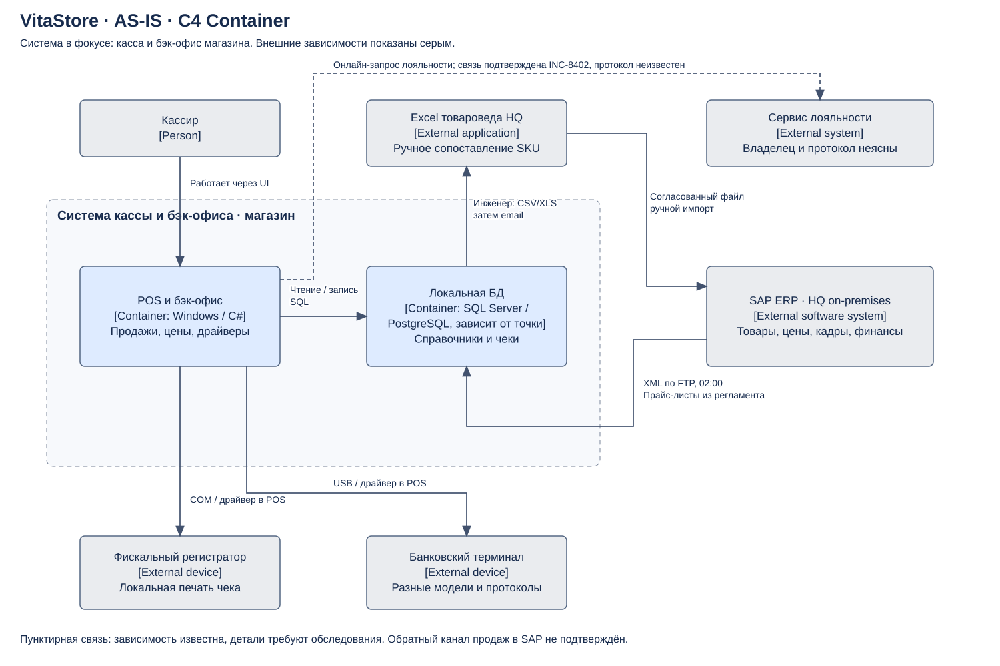
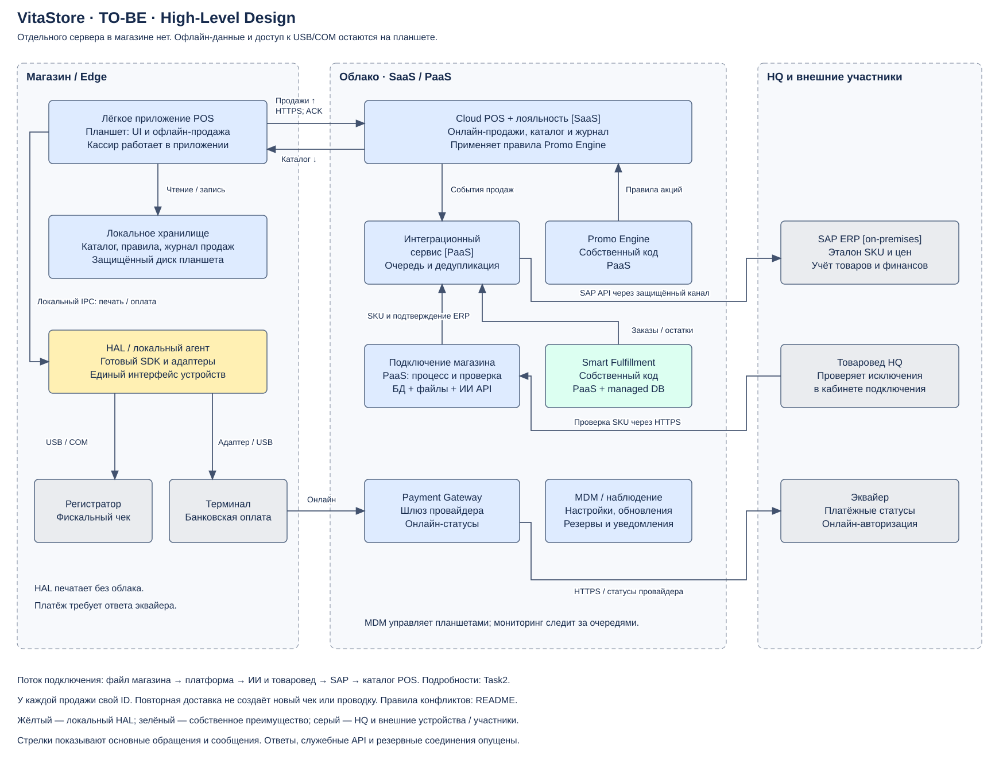

# Задание 3. Архитектура магазина

## Что исправлено в AS-IS

| В исходной схеме или пожелании | Что говорят материалы | Решение |
| --- | --- | --- |
| HQ назван Cloud | Контекст прямо называет SAP on-premises | Показываем SAP в центральном офисе |
| POS передаёт остатки и лояльность в SAP по REST в реальном времени | Регламент: выгрузка CSV/XLS, письмо, ручной VLOOKUP, ночной XML по FTP в 02:00 | Убираем неподтверждённый real-time канал; показываем файловый обмен |
| Лояльность включена в SAP без пояснения | INC-8402 подтверждает онлайн-зависимость, но не владельца сервиса | Показываем внешний сервис лояльности, размещение требует уточнения |
| Одна модель терминала и одна БД | Контекст: разные терминалы, MS SQL Server / PostgreSQL | На схеме перечисляем варианты, не считаем все магазины одинаковыми |
| Только планшет и регистратор | Нужны банковский терминал и связь | Убираем сервер, сохраняем платёжное устройство и маршрутизатор |
| Адаптация под любые терминалы автоматически | INC-8415: новый протокол требует разработки | Поддерживаем проверенный список адаптеров; неизвестное устройство требует проверки или замены |

Область C4 Container: система кассы и бэк-офиса магазина. Внутри неё выделены приложение и локальная БД; SAP, Excel товароведа, лояльность и устройства показаны как внешние зависимости. Подписи содержат назначение и известные технологии. Это соответствует назначению [C4 Container diagram](https://c4model.com/diagrams/container). Promo Engine и Smart Fulfillment существуют в HQ, но точные текущие связи с POS не описаны, поэтому их не выдумываем. Канал обратной передачи продаж в SAP также требует обследования.

## Целевая схема

Это High-Level Design с границами магазина, облака и HQ. На планшете работает лёгкое приложение Cloud POS с локальным хранилищем и HAL. Его основная логика учёта находится в SaaS; локально остаётся минимум для наличной продажи и фискального чека. Встраиваемое хранилище на планшете не требует отдельного сервера БД. Полностью «без состояния» браузерная страница этому требованию не подходит.

| Компонент | Ответственность | Данные / модель |
| --- | --- | --- |
| Cloud POS | Продажи, возвраты, смены, лояльность, выдача версии каталога | SaaS; журнал принятых продаж |
| Планшет POS | Интерфейс, офлайн-корзина, сохранение незавершённых операций | Подписанный каталог и правила, защищённый журнал на диске |
| HAL на планшете | Единый интерфейс печати, оплаты и проверки статуса | Готовые адаптеры под ОС, устройство и протокол |
| Payment Gateway | Онлайн-взаимодействие с платёжным провайдером, сверка статусов | Платёжные идентификаторы; без хранения карточных реквизитов в POS |
| Платформа подключения | Процесс из Task2, правила сопоставления, задания товароведу | PaaS-приложение, управляемая БД, файлы в объектном хранилище |
| Интеграционный сервис | Обмен с SAP, повторы, сверка чеков и импортов | Очередь, реестр обработанных идентификаторов |
| SAP | Эталон SKU, цены, товарный и финансовый учёт, кадры | Существующая on-premises ERP |
| Promo Engine | Единые правила акций | Собственный сервис на PaaS; пакет правил для кассы |
| Smart Fulfillment | Распределение заказов и Click & Collect | Собственный сервис на PaaS и управляемая БД |
| MDM и мониторинг | Настройка, обновления, контроль очереди и состояния устройств | SaaS и облачные средства наблюдения |

SaaS должен поддерживать API продаж, версионированные каталоги и внешний расчёт акций. Если этих возможностей нет, такой продукт не подходит для выбранной архитектуры. SAP не подключаем напрямую к интернету: интеграционный сервис использует защищённый канал и отдельную техническую учётную запись.

## Как работает HAL

POS вызывает `printReceipt`, `pay`, `getPaymentStatus` и `getFiscalStatus`. HAL выбирает установленный адаптер, например для ARCUS-2, и общается с устройством по USB/COM или локальной сети. Нативный агент работает на том же планшете и доступен только приложению POS; публичного порта управления печатью нет. Облачный шлюз не обращается к USB напрямую.

Выбираем ОС планшета после проверки SDK устройств. Для старого терминала без подходящего адаптера заранее планируем замену. Драйвер обновляется отдельно от кассового приложения, но проходит тест с конкретной прошивкой. Платёж получает уникальный идентификатор; при тайм-ауте сначала запрашиваем статус у провайдера, а не повторяем списание. Неопределённый результат уходит на сверку.

## Офлайн-продажа

До открытия смены касса получает каталог цен, разрешённые правила скидок и остатки для справки. Проектное ограничение: автономная работа до 24 часов при действующих локальных правилах; фактический срок проверяем с бизнесом и поставщиком кассы. Это не утверждение о правовых ограничениях. Товары с отдельными требованиями проверки не продаём офлайн, пока такой сценарий не согласован.

При пропадании связи кассир принимает наличные. POS сначала сохраняет намерение продажи, затем HAL передаёт чек регистратору и возвращает номер фискального документа. После этого POS отмечает продажу как завершённую. При перезапуске между печатью и записью результата касса сверяет статус с регистратором; повторный чек автоматически не печатает. Неясный результат блокирует повтор операции до проверки кассиром.

Баллы офлайн не списываем; начисление возможно после передачи продажи и только при наличии идентификатора покупателя. Банковскую оплату разрешаем лишь при подтверждённом онлайн-ответе провайдера, например по отдельному каналу терминала. Без такого ответа остаются наличные. Онлайн-заказы и обещание наличия товара отключаем: локальный остаток может устареть. При заполнении диска, истечении допустимой версии данных или неисправности регистратора касса блокирует продажу и показывает причину.

## Синхронизация после восстановления связи

Планшет отправляет завершённые продажи из локального журнала небольшими пакетами. У каждой продажи есть `store_id`, `device_id`, `sale_id`, номер в последовательности устройства, время, версия цен и номер фискального документа. Облако сохраняет событие и ключ уникальности в одной транзакции, затем подтверждает приём. При потере ответа планшет повторяет отправку с тем же ключом. Повтор не создаёт вторую продажу. До подтверждения запись остаётся на планшете; после подтверждения сохраняется на срок локального аудита.

Интеграционный сервис доставляет принятые продажи в SAP через очередь. Он сверяет результат по тому же идентификатору, поэтому сбой после записи в ERP не создаёт повторную проводку. Необработанные события попадают в очередь ошибок с уведомлением владельцу. Касса может продолжать работу, пока SAP догоняет поток. Закрытие смены включает сверку количества и сумм чеков между планшетом, SaaS, SAP и регистратором; расхождения разбирает Store Ops вместе с финансами.

После выгрузки продаж касса получает новую версию справочников и правил. Она проверяет подпись и полноту пакета и заменяет его целиком между чеками. Уже пробитые чеки сохраняют старые цены; обновление не пересчитывает их задним числом. Остатки восстанавливаем по событиям, а не заменой центрального значения локальным. Отмены и возвраты передаём отдельными событиями со ссылкой на исходную продажу. Конфликты разбирает ответственный сотрудник.

## Надёжность и переход

Облачные приложения разворачиваем минимум в двух зонах доступности, если это поддерживает выбранный сервис. Для управляемой БД на пилоте проверяем резервную копию и восстановление. Начальные цели: доступность онлайн-кассы 99,9% в месяц, доставка очереди после восстановления связи до 15 минут для 1 000 чеков на устройство. Это требования к проверке, а не измеренные показатели.

Несинхронизированные чеки уязвимы при потере планшета. Шифрование защищает данные, но не восстанавливает их. Регистратор помогает сверить фискальные документы; полноту товарного учёта восстанавливают по доступным журналам. Для снижения риска нужны резервная связь, контроль очереди и запасной настроенный планшет. Обещать нулевую потерю данных в таком сценарии нельзя.

| Этап | Действие | Условие перехода |
| --- | --- | --- |
| Первые 2 месяца | Проверить тарифы и оборудование, собрать платформу подключения, провести пилот на 5 магазинах | Успешные офлайн-чеки, сверка, подтверждённое качество SKU и стоимость |
| Месяцы 3–6 | Подключать типовые магазины волнами; на смене работает одна кассовая система | Акты сверки, обучение, очередь ошибок в пределах согласованного срока |
| Месяцы 7–12 | Перевести остальные готовые точки, перенести Promo Engine и Smart Fulfillment после отдельных проверок | Приёмка нагрузочных проверок и восстановления, подтверждение экономии |
| После приёмки каждой точки | Архивировать данные старого сервера и вывести его из эксплуатации | Все продажи сверены, сроки хранения согласованы, откат больше не нужен |

Перед переключением закрываем старую смену, фиксируем остатки и проверяем новую кассу. При откате сначала сверяем уже пробитые чеки, затем открываем смену в прежней системе. Одновременная запись в две кассы запрещена. Правила доступа разделяют кассира, товароведа и администратора; действия с ценами и соответствиями SKU пишутся в аудит.

Проверки пилота: обрыв интернета, повтор сообщения, падение питания после печати, тайм-аут платежа, недоступность SAP, повреждённый каталог, восстановление БД и подключение каждой поддерживаемой модели терминала.
